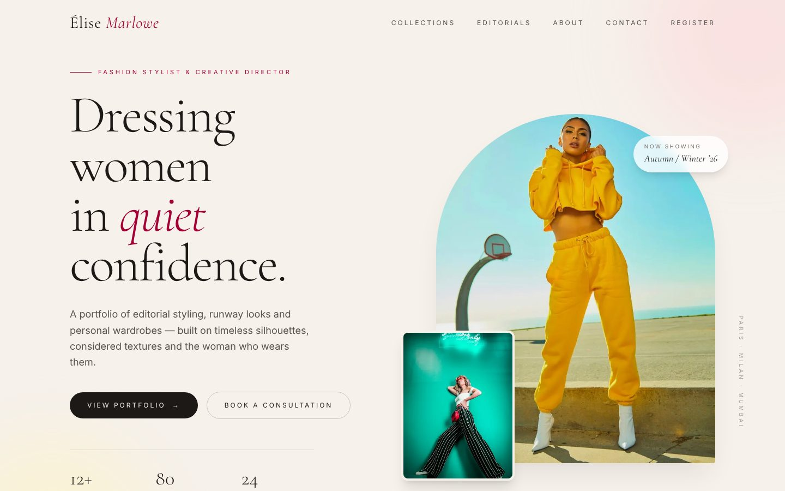
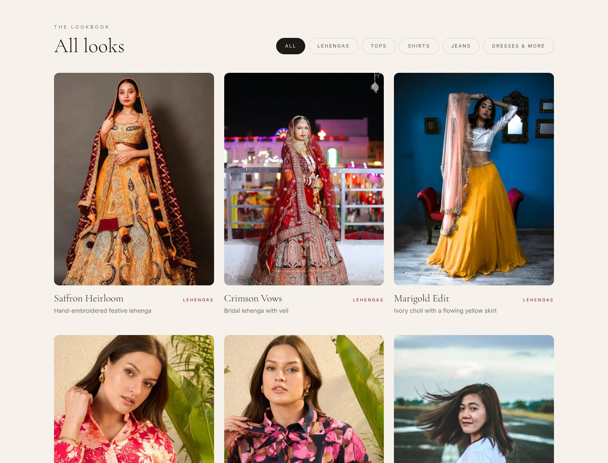
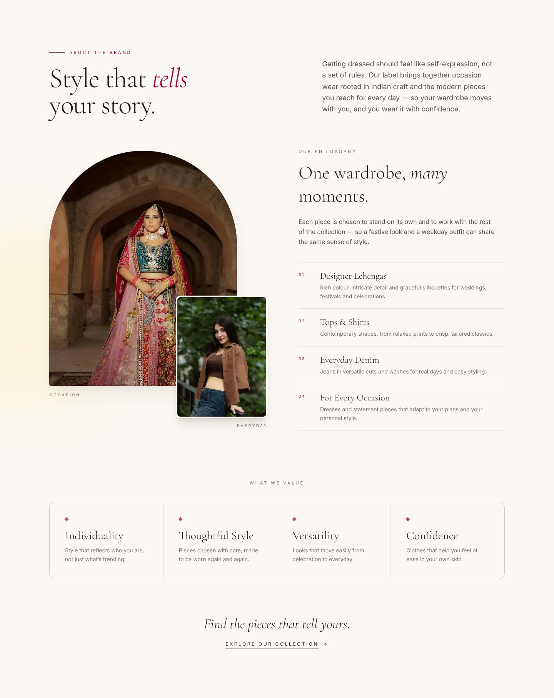
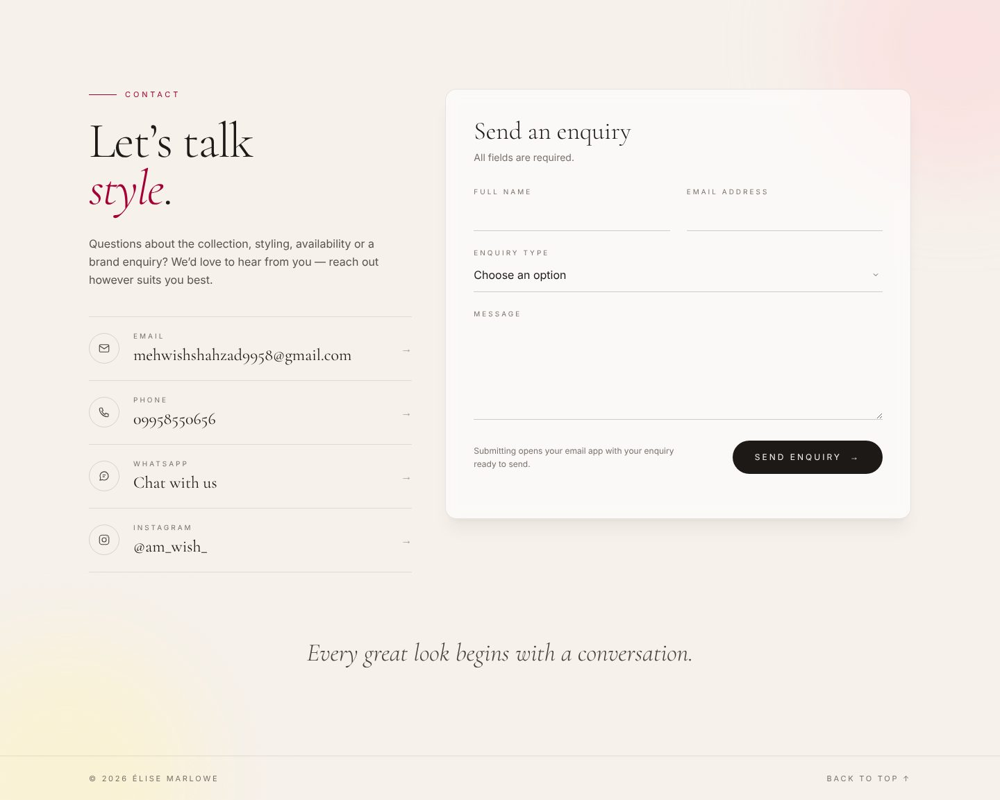
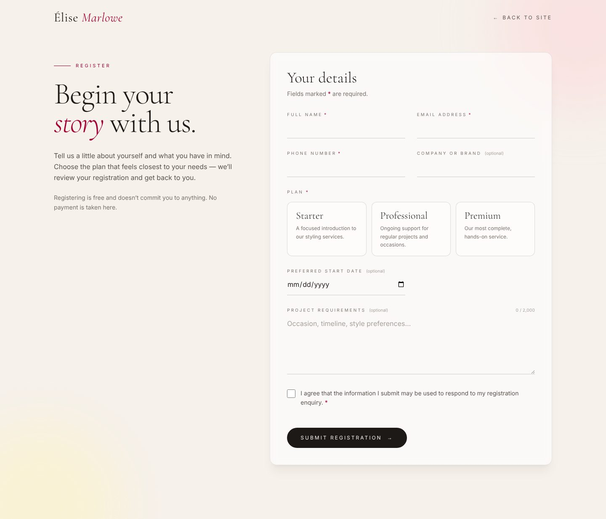
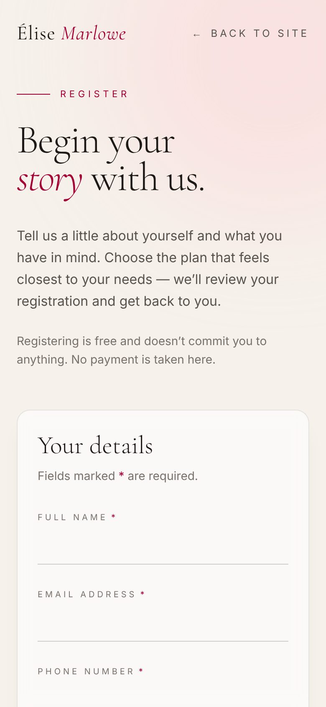

# Élise Marlowe — Fashion Portfolio

An editorial, responsive portfolio website for a women's fashion stylist and label — traditional Indian occasion wear alongside contemporary everyday pieces — with a secure client registration page backed by Supabase.

Built with **Next.js 16 (App Router)**, **React 19**, **TypeScript** and **Tailwind CSS 4**.



---

## Contents

- [Features](#features)
- [Screenshots](#screenshots)
- [Tech stack](#tech-stack)
- [Getting started](#getting-started)
- [Supabase setup (client registration)](#supabase-setup-client-registration)
- [Available scripts](#available-scripts)
- [Project structure](#project-structure)
- [How client registration works](#how-client-registration-works)
- [Customising the content](#customising-the-content)
- [Deployment](#deployment)
- [Known limitations](#known-limitations)
- [Credits](#credits)

---

## Features

**Homepage**
- **Hero** — arched editorial imagery, serif headline, navigation with a mobile menu.
- **Collection Showcase** — five category cards (Lehengas, Tops, Shirts, Jeans, Dresses & More) that open a filterable **lookbook**. Filters update the URL (e.g. `/#collection-jeans`) so links can be shared.
- **About the Brand** — brand story, philosophy, and values.
- **Contact** — email, phone, WhatsApp and Instagram links, plus an enquiry form that opens the visitor's own email app with the enquiry pre-filled.

**Client registration (`/register`)**
- Visitors register their interest and choose a plan (Starter, Professional or Premium — labels only, no prices or payments).
- Submissions are validated in the browser **and** on the server, then stored in **Supabase PostgreSQL**.
- The database table is locked down: the website can only *insert* rows; nobody can read registrations from the browser.
- Lightweight spam deterrents: a hidden honeypot field and a minimum submission time.

**Design**
- Warm cream backgrounds, rose accents, Cormorant Garamond + Inter typography, pill buttons.
- Fully responsive (mobile, tablet, desktop), keyboard accessible, with visible focus states.

---

## Screenshots

### Collections and lookbook



### About the brand


### Contact


### Client registration


### Mobile
<p>
  
  &nbsp;&nbsp;
  
</p>

---

## Tech stack

| Area | Technology |
|---|---|
| Framework | [Next.js 16](https://nextjs.org/) (App Router, Server Actions) |
| UI | React 19, [Tailwind CSS 4](https://tailwindcss.com/) |
| Language | TypeScript |
| Fonts | Cormorant Garamond and Inter via `next/font/google` |
| Images | `next/image` (sample photography from Unsplash) |
| Database | [Supabase](https://supabase.com/) PostgreSQL via `@supabase/supabase-js` |
| Safety | `server-only` (prevents server code from being bundled into the browser) |

---

## Getting started

### Prerequisites
- **Node.js 20.9 or newer** (required by Next.js 16)
- npm
- A free **Supabase** project — only needed for the `/register` page. The rest of the site runs without it.

### 1. Install dependencies
```bash
npm install
```

### 2. Configure environment variables
Copy the template and fill in your own values:
```bash
# macOS / Linux
cp .env.example .env.local
# Windows PowerShell
Copy-Item .env.example .env.local
```

| Variable | Where to find it | Exposed to the browser? |
|---|---|---|
| `NEXT_PUBLIC_SUPABASE_URL` | Supabase dashboard → your project → **Connect** (or Project Settings → Data API) | Yes — it is not a secret |
| `NEXT_PUBLIC_SUPABASE_PUBLISHABLE_KEY` | Project Settings → **API Keys** → Publishable key (`sb_publishable_…`) | Yes — safe by design; not used by registration |
| `SUPABASE_SECRET_KEY` | Project Settings → **API Keys** → Secret keys (`sb_secret_…`) | **No — server only** |

> ⚠️ **Never commit `.env.local`** (it is already in `.gitignore`), never paste the secret key into code, chat or screenshots, and never add a `NEXT_PUBLIC_` prefix to it. If it leaks, delete it in Supabase and create a new one.

### 3. Run the development server
```bash
npx next dev --webpack
# or
npm run dev
```
Open <http://localhost:3000>. The registration page is at <http://localhost:3000/register>.

---

## Supabase setup (client registration)

1. Create a project at [supabase.com](https://supabase.com/).
2. Open **SQL Editor → New query**, paste the contents of [`supabase/schema.sql`](supabase/schema.sql) and click **Run**.
   - It creates the `public.registrations` table with validation constraints and indexes, turns on Row Level Security, and grants the server **insert-only** access.
   - It runs as a single transaction and refuses to run twice, so it never overwrites existing data.
   - Supabase may warn *"RLS enabled, no policies"* — that is intentional.
3. Add the three environment variables above to `.env.local` and restart the dev server.
4. Submit a test registration at `/register` and confirm the row in **Table Editor → registrations**.

**Troubleshooting**
- `PGRST205` (table not found in schema cache): run `notify pgrst, 'reload schema';` in the SQL Editor.
- `42501` (permission denied): check that `SUPABASE_SECRET_KEY` holds an `sb_secret_…` key, not the publishable key.
- *"Not configured: missing …"* in the server log: a variable is missing from `.env.local` (only variable **names** are ever logged).

---

## Available scripts

| Command | What it does |
|---|---|
| `npx next dev --webpack` / `npm run dev` | Start the development server |
| `npm run build` | Create a production build |
| `npm run start` | Serve the production build |
| `npx tsc --noEmit` | Type-check the project |

---

## Project structure

```
web/
├─ app/
│  ├─ layout.tsx               # Root layout and metadata
│  ├─ page.tsx                 # Homepage: Hero → Collections → About → Contact
│  ├─ globals.css              # Tailwind import + lookbook animation
│  ├─ register/page.tsx        # /register page
│  └─ actions/register.ts      # Server Action: validate + insert registration
├─ components/
│  ├─ Hero.tsx                 # Header, navigation, hero
│  ├─ CollectionShowcase.tsx   # Category grid + filterable lookbook
│  ├─ AboutBrand.tsx           # About the brand
│  ├─ ContactSection.tsx       # Contact details + mailto enquiry form
│  ├─ RegistrationForm.tsx     # Client registration form (client component)
│  └─ collection/              # Cards, image fallback, collection data, fonts
├─ lib/
│  ├─ registration.ts          # Plans, limits and validation (shared by browser + server)
│  └─ supabase/server.ts       # Server-only Supabase client (secret key)
├─ supabase/schema.sql         # Database table, constraints, RLS and permissions
├─ docs/screenshots/           # Images used in this README
├─ .env.example                # Environment variable template (no values)
└─ next.config.ts              # Allows images from images.unsplash.com
```

---

## How client registration works

```
Browser (/register)                     Server (Next.js)                     Supabase
───────────────────                     ────────────────                     ────────
RegistrationForm ──── Server Action ──▶ app/actions/register.ts
 • instant field validation              1. honeypot check
 • honeypot + start time                 2. timing check (≥ 3 s)
                                         3. full validation (lib/registration.ts)
                                         4. lib/supabase/server.ts ─ insert ──▶ public.registrations
                                            (secret key, server-only)            RLS on, insert-only
◀──── status + message only ───────────  never returns or logs form data
```

**Security measures**
- The secret key is read only in `lib/supabase/server.ts`, which starts with `import "server-only"`; the build fails if browser code ever imports it.
- The browser never talks to Supabase directly and never receives any key.
- Every field is validated again on the server; plans must be one of `starter`, `professional`, `premium`.
- The database enforces the same rules with `CHECK` constraints, so invalid rows are rejected even if the app is bypassed.
- Row Level Security is enabled with no policies, and `anon`/`authenticated` roles have no table privileges. The server role can **insert only** — it cannot read, update or delete rows.
- Inserts use `.insert(row)` only (no `.select()` / `.upsert()`), so no data is ever read back.
- Errors shown to visitors are generic; logs contain only error codes — never names, emails, phone numbers, messages or database error details.

**Data stored per registration:** full name, email, phone, optional company/brand, plan, optional preferred start date, optional project requirements, consent (required) with timestamp, creation time, and a `status` (default `new`) for future follow-up.

---

## Customising the content

| What | Where |
|---|---|
| Collection categories, lookbook items and their photos | `components/collection/collectionData.ts` |
| Hero text, stats and photos | `components/Hero.tsx` |
| About the brand text and photos | `components/AboutBrand.tsx` |
| Contact details (email, phone, WhatsApp, Instagram) | `contactConfig` at the top of `components/ContactSection.tsx` |
| Registration plans (labels and descriptions) | `PLANS` in `lib/registration.ts` |
| Page title and description | `app/layout.tsx` |

**Using your own photos:** put them in a `public/` folder (e.g. `public/collections/lehenga-1.jpg`) and change the image path to `/collections/lehenga-1.jpg`. Once no Unsplash images remain, the `remotePatterns` entry in `next.config.ts` can be removed.

**Changing plan values:** labels and descriptions can be edited freely. If you add, remove or rename a plan **value**, also update the `registrations_plan_allowed` constraint in the database (an example is at the bottom of `supabase/schema.sql`).

---

## Deployment

The site can be deployed to any platform that supports Next.js — for example [Vercel](https://vercel.com/):

1. Import the GitHub repository into Vercel.
2. In **Project Settings → Environment Variables**, add `NEXT_PUBLIC_SUPABASE_URL`, `NEXT_PUBLIC_SUPABASE_PUBLISHABLE_KEY` and `SUPABASE_SECRET_KEY` (do not upload `.env.local`).
3. Deploy.

---

## Known limitations

- **Contact form** — it does not send email from the server; it opens the visitor's email app with the enquiry pre-filled.
- **Spam protection** — the honeypot and timing check stop simple bots only. There is no rate limiting yet; Cloudflare Turnstile or a rate limiter can be added if spam appears.
- **Registration requires JavaScript** — without it, the submit button stays disabled.
- **"Editorials" navigation link** — there is no Editorials section yet.
- **Admin view** — registrations are reviewed in the Supabase Table Editor; there is no admin dashboard.

---

## Credits

- Sample photography from [Unsplash](https://unsplash.com/) (free to use under the Unsplash License). Replace with your own photography before launch.
- Fonts: [Cormorant Garamond](https://fonts.google.com/specimen/Cormorant+Garamond) and [Inter](https://fonts.google.com/specimen/Inter) from Google Fonts.

## License

No license has been chosen for this project yet. All rights reserved by the owner unless a license is added.
